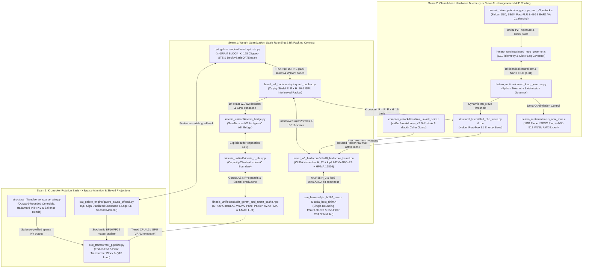
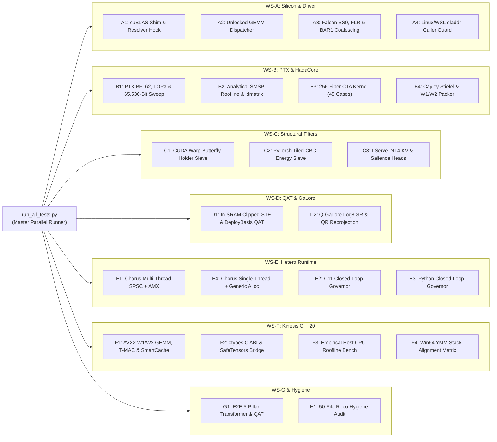

# 16. Subsystem Audit, Interleaving Seams, and Adversarial Testing Architecture

This document records the complete architectural audit of the Unified Hardware Acceleration (UHA) co-design stack:
1. The **Adversarial "Try-to-Break-It" & Interleaving-Seam Testing Philosophy**.
2. **Visual Architecture Graphs** mapping how the 9 engineering workstreams interleave across 4 cross-language seams and how the 23 verification suites exercise them.
3. The **Part-by-Part Individual Subsystem Audit**, detailing the mathematical and hardware invariants of each module, the adversarial inputs constructed to break them in isolation, and the regression suites that lock them in.
4. The **Subsection Interleaving & Seam Audit**, analyzing how data, quantization scales, bit-packed words, orthogonal rotations, and hardware telemetry cross between Python, C++20, CUDA/PTX, and C11.
5. The **Complete Record of Verification Passes and Changes** (`F1..F21`, `O1..O17`, and `4.1..4.31`).

---

## 1. Adversarial "Try-to-Break-It" & Seam Verification Philosophy

Single-file happy-path tests are insufficient for a multi-language hardware/systems co-design stack. When a subsystem is tested only on its own terms with well-formed Gaussian inputs, two major classes of defects escape detection:
- **Intra-Module Invariant Negation:** Edge cases that violate implicit assumptions inside a single routine, such as IEEE-754 `NaN` unordered comparisons (`NaN > 0.0` and `NaN <= tau` both evaluating to `false`), `±Inf / Inf = NaN` ratios cast to integer types, sentinel value collisions (`-1e9` masks vs. valid scores `< -1e9`), zero-width window slices, or Windows x64 16-byte stack frames receiving 32-byte aligned YMM vector spills.
- **Inter-Module Seam Divergence:** Subtle mismatches where two modules written in different languages (e.g., Python calibration vs. C++20 GotoBLAS panel packing vs. CUDA `lop3.b32` register unpacking, or C11 vs. Python closed-loop telemetry governors) implement the *same* nominal specification but diverge on tie-breaking, subnormal rounding, buffer capacity checks, or non-finite fallbacks.

To close both defect classes, every verification pass in this repository enforces five mandatory rules:

| Rule | Name | Engineering Requirement |
| :--- | :--- | :--- |
| **Rule 1** | **Cross-Boundary Seam Differential Probing** | Never test a shared format on only one side of a language boundary. Feed the exact same adversarial inputs (including mixed `[+Inf, -Inf, NaN, +2.5, -2.5, 0.0]` within the same 128-weight group, all-zero groups, subnormal BF16 scales, and non-multiple-of-128 shapes) into both sides of every Python $\leftrightarrow$ C++20 $\leftrightarrow$ CUDA $\leftrightarrow$ C11 seam and assert `0`-bit divergence. |
| **Rule 2** | **IEEE-754 Non-Finite Predicate & Cast Audit** | Audit every floating-point comparison (`<`, `>`, `<=`, `>=`), `max(0.0, x)` builtin, sort comparator (`std::sort` / `std::partial_sort`), and float-to-integer cast (`.to(torch.int*)`, `static_cast<int>`) under `x = NaN` and `±Inf / Inf = NaN`. |
| **Rule 3** | **Sentinel & Boundary-Value Collision Testing** | Whenever an algorithm uses a magic floating-point sentinel (such as `-1e9` to mask static KV pages) or slices static windows (`[:sink]`, `[-local:]`), construct valid inputs whose scores fall below the sentinel (`< -1e9`) and test boundary window sizes of `0` and `>= N`. |
| **Rule 4** | **Mandatory Sibling Sweep** | Whenever a defect pattern is uncovered in one file, grep the entire repository for the same syntactic pattern and audit every sibling occurrence before closing the finding. |
| **Rule 5** | **Permanent Regression Lock-In** | Every defect discovered during an audit pass must be turned into a permanent assertion in `run_all_tests.py` so it can never regress silently. |

---

## 2. Visual Architecture: Subsystem Interleaving & Verification Seams

### 2.1 Cross-Language Subsection Interleaving & Seam Graph

The diagram below illustrates how the 9 workstreams interleave across the 4 primary architectural seams:

### 2.2 Master Verification & Build Matrix Pipeline (`run_all_tests.py` - 23 Suites)

---

## 3. Part-by-Part Individual Subsystem Audit & Testing Schemes

### 3.1 Workstream 1: `sim_harness/` (PTX Instruction Emulator & Analytical SMSP Roofline)
- **Files:** [`sim_harness/ptx_bf162_emu.c`](../sim_harness/ptx_bf162_emu.c), [`sim_harness/cuda_host_shim.h`](../sim_harness/cuda_host_shim.h), [`sim_harness/smsp_roofline_sim.py`](../sim_harness/smsp_roofline_sim.py)
- **Core Responsibilities:**
  - Bit-exact C11 emulation of `lop3.b32`, single-rounding `fma.rn.bf16x2`, `mma.sync.aligned.m16n8k16.row.col.f32.bf16.bf16.f32`, and 32-lane warp butterfly shuffles.
  - Cooperative 256-fiber CTA execution engine (`cuda_host_shim.h`) enabling multi-warp CUDA `__global__` kernels with `__syncthreads()` barriers to execute deterministically on the host CPU.
  - Analytical SMSP roofline model quantifying 32-bank SRAM crossbar demand vs. Tensor Core issue intervals, `Swizzle<3,3,3>` bank-conflict elimination, and `ldmatrix` latency hiding.
- **How We Tried to Break It (Individual Audit):**
  - **Double-Rounding Trap (`3.13`, `4.20`, `4.28`):** Computing $a \cdot b + c$ in `float32` and then rounding to `bf16` double-rounds when $a \cdot b + c$ lands on a `bf16` midpoint (28,019 counterexamples across 24.7M random triples). Replaced with [`round_f64_to_bf16_rne`](../sim_harness/ptx_bf162_emu.c), which evaluates $a \cdot b + c$ in exact IEEE-754 `double` (53-bit mantissa) and rounds once to `bf16` (including subnormal exponent clamping at `-133`).
  - **Exhaustive 65,536-Pattern Bit Sweep (`4.28`):** Swept all $2^{16}$ 16-bit patterns across `ptx_bf162_emu.c` and `cuda_host_shim.h` to verify identical handling of quiet/signaling `NaN`s, `±Inf`, `±0.0`, and subnormals.
  - **PTX `max.bf16x2` NaN Semantics (`4.17`):** Verified that `ptx_max_bf162` returns the non-`NaN` operand when one lane is `NaN` and canonical `0x7FC0` when both are `NaN`.
  - **Single-Source Roofline FLOP Accounting (`4.7`, `4.18`):** Enforced `FLOPS_PER_HMMA_16816 = 4096` across both `peak_tflops` and `t_mma` with an explicit runtime assertion that implied instruction throughput equals peak TFLOPS, plus optional `ldmatrix` exposed-latency modeling (`B2 [1b]`).
- **Verification Suites:** `B1` (`ptx_bf162_emu.exe`), `B2` (`smsp_roofline_sim.py`).

### 3.2 Workstream 2: `compiler_unlock/` (Driver Interposition & Heuristic Dispatcher)
- **Files:** [`compiler_unlock/libcublas_unlock_shim.c`](../compiler_unlock/libcublas_unlock_shim.c), [`compiler_unlock/test_cublas_shim.c`](../compiler_unlock/test_cublas_shim.c), [`compiler_unlock/test_shim_dladdr_linux.c`](../compiler_unlock/test_shim_dladdr_linux.c), [`compiler_unlock/verify_shim_dladdr_linux.py`](../compiler_unlock/verify_shim_dladdr_linux.py), [`compiler_unlock/unlocked_gemm.py`](../compiler_unlock/unlocked_gemm.py)
- **Core Responsibilities:**
  - `LD_PRELOAD` interposer intercepting `cuDeviceGetAttribute`, `cudaDeviceGetAttribute`, `cuDeviceGetName`, `cuGetProcAddress`, `cuGetProcAddress_v2`, and `/dev/nvidiactl` `ioctl` (`NV_ESC_RM_CONTROL = 0x2A`) to evaluate workstation tile schedules while preserving true device attributes for non-library callers.
  - 8-warp, 4/5-stage Triton GEMM configurations bounded within `101,376 B` per-SM shared memory.
- **How We Tried to Break It (Individual Audit):**
  - **CUDA 12.x Recursive Symbol Resolution (`F12`):** Called `cuGetProcAddress_v2("cuGetProcAddress_v2", ...)` to try to bypass the shim and obtain the raw driver function pointer; verified the shim self-hooks its own resolver without infinite recursion.
  - **Caller-Gating Spoof Leak (`O2`, `4.16`, `4.25`):** Built real shared libraries (`libcublasLt_mockcaller.so` vs. a non-cuBLAS caller DSO) on Linux/WSL (`Suite A4`) to verify `dladdr` stack classification spoofs the workstation profile *only* when called from a `cublas`/`cudnn` DSO.
  - **Unbounded `ioctl` Name Scan (`4.17`):** Crafted a non-NUL-terminated 64-byte `NV0000_CTRL_GPU_GET_NAME_STRING_PARAMS` buffer with bait text past byte 64; verified the shim copies into a bounded NUL-terminated buffer before calling `strstr`.
- **Verification Suites:** `A1` (`test_cublas_shim.exe`), `A2` (`unlocked_gemm.py`), `A4` (`verify_shim_dladdr_linux.py`).

### 3.3 Workstream 3: `kernel_driver_patch/` (Falcon HS Mock, S3/S4 Resume & 48 GB BAR1 Aperture Manager)
- **Files:** [`kernel_driver_patch/nv_gpu_ops_and_s3_unlock.c`](../kernel_driver_patch/nv_gpu_ops_and_s3_unlock.c), `01..03-*.patch`, `nvidia-p2p.conf`
- **Core Responsibilities:**
  - Host-verifiable C11 model of `nv-gpu-ops.c` covering ephemeral open-and-relock MMIO sequences, S3/S4 early resume (`nv_pci_resume_early_unlock`), PCIe Function-Level Reset (FLR) recovery, isolated IOMMU peer BDF whitelisting, and dynamic BAR1 GMMU aperture management (`kbusMapFbAperture_HAL`) for 48 GB configurations.
- **How We Tried to Break It (Individual Audit):**
  - **Cold-Slot Partial Physical Overlap (`4.20` / Audit Check 11):** Constructed a 3-step sequence (map 16 MB at 33 GB and unmap so slot 0 is cold; map 8 MB at 33 GB into slot 1 so slot 1 is live; re-map 16 MB at 33 GB). Previously, Step 1 took the exact cache hit on cold slot 0 at `i = 0` before seeing live overlapping slot 1 at `i = 1`, leaving two live slots aliasing physical VRAM! Fixed by scanning all 8 slots before taking `exactHitSlot` and invalidating any cold slot that partially overlaps `[physTarget, physTarget + reqSize)`.
  - **Mixed-Size BAR1 VA Fragmentation (`Caveat 2.1` / Audit Check 11):** Executed 200 steps of mixed `8 MB`, `16 MB`, and `32 MB` allocations on a `64 MB` aperture with pinned live mappings. Added a first-fit coalescing BAR1 VA gap allocator over active (`refCount > 0`) intervals and verified pairwise BAR1 VA and physical FB disjointness at every step (`A3 [2b-3]`).
- **Verification Suite:** `A3` (`test_kernel_patch.exe`).

### 3.4 Workstream 4: `fused_w1_hadacore/` (HadaCore CUDA Kernel & SpinQuant Stiefel Packer)
- **Files:** [`fused_w1_hadacore/w1a16_hadacore_kernel.cu`](../fused_w1_hadacore/w1a16_hadacore_kernel.cu), [`fused_w1_hadacore/w1a16_host_cta_shim.hpp`](../fused_w1_hadacore/w1a16_host_cta_shim.hpp), [`fused_w1_hadacore/w1a16_host_verify_main.hpp`](../fused_w1_hadacore/w1a16_host_verify_main.hpp), [`fused_w1_hadacore/spinquant_packer.py`](../fused_w1_hadacore/spinquant_packer.py)
- **Core Responsibilities:**
  - Cayley Stiefel manifold rotation optimizer ($R = R_P \otimes H_{16}$) and Interleaved 16-Bit Split `uint32` bit-packer for `W1` (`1.125 bpw`) and `W2` (`2.125 bpw`).
  - Fused 256-thread CTA CUDA kernel executing online $H_{32} = H_2 \otimes H_{16}$ activation rotation, `Swizzle<3,3,3>` shared-memory staging, register-resident `lop3.b32` (`0xAE` / `0xEA`) + `fma.rn.bf16x2` weight unpacking, and `mma.sync.aligned.m16n8k16` accumulation.
- **How We Tried to Break It (Individual Audit):**
  - **45-Case Cooperative CTA & Warp Verification (`Suite B3`):** Exercised ragged `(M, N, K)` boundaries (`M=1..33`, `N=1..17`), non-multiple-of-128 `K` error returns, negative weights, zero scales, `NaN` propagation, and `Swizzle<3,3,3>` bank-conflict freedom across all 32 warp lanes.
  - **Cayley Descent vs. Hadamard Initialization (`4.16`):** Verified `cayley_sgd_stiefel_step` strictly reduces activation kurtosis below the initial block-Hadamard baseline (`25.00 -> 2.59 -> 1.82`) while preserving $\|R^\top R - I\|_F < 10^{-5}$.
- **Verification Suites:** `B3` (`test_w1a16_kernel.exe`), `B4` (`spinquant_packer.py`).

### 3.5 Workstream 5: `structural_filters/` (Tiled-CBC Hölder Energy Sieve & LServe Sparse Attention)
- **Files:** [`structural_filters/tiled_cbc_sieve.cu`](../structural_filters/tiled_cbc_sieve.cu), [`structural_filters/tiled_cbc_sieve.py`](../structural_filters/tiled_cbc_sieve.py), [`structural_filters/lserve_sparse_attn.py`](../structural_filters/lserve_sparse_attn.py)
- **Core Responsibilities:**
  - Worst-case per-output Hölder $(1, \infty)$ row-max activation sieve ($\max_m \|X_{m,g}\|_1 \cdot \max_n |\alpha_{g,n}|$) pruning sub-threshold $K$-sub-tiles before weight loads.
  - LServe hierarchical sparse attention combining outward-rounded INT4 KV page centroids, Hadamard INT4 KV compression, and salience-profiled streaming heads.
- **How We Tried to Break It (Individual Audit):**
  - **1-Loud-Row / 63-Zero-Row Batch Attack (`O9`, `4.16`):** Constructed an activation batch with 63 zero rows and 1 active row. Confirmed the legacy batch-mean heuristic falsely prunes the tile (dropping a true contribution of `16.0 > tau = 10.0`), whereas the Hölder row-max sieve preserves it with `0.0` error.
  - **`NaN` Activation Poisoning (`4.12`):** Replaced `fmaxf` / `bound > tau` with NaN-sticky reductions and `!(bound <= tau)` so any tile containing `NaN` is forced active and propagates `NaN` faithfully to the output.
  - **Outward Centroid Rounding (`4.17`):** Verified page min/max centroids use outward `floor`/`ceil` rounding (`0 / 8,192` upper-bound containment violations, whereas round-to-nearest-even violated containment on `4,121 / 8,192` maxima).
  - **Static-Page Sentinel Collision & Zero-Window Crash (`4.30` - Sixth Pass):** When candidate page upper-bound scores were `< -1e9` (e.g., `q = 1e5, k = -1e5` giving `-1.28e12`), masking static pages with `-1e9` caused `torch.topk` to re-select static pages (`-1e9 > -1.28e12`) instead of dynamic candidate pages! Furthermore, `sink_pages = 0, local_pages = 0` crashed `profile_streaming_head_mask` on an empty `amax` reduction. Fixed by running `torch.topk` strictly over non-static candidate indices (`cand_idx = torch.nonzero(~static_mask[0, 0])`) and guarding `0`-width static windows (`C3 [8]`).
  - **KV Page `±Inf / Inf = NaN` Cast (`4.29` - Sixth Pass):** Guarded `k_ratio` and `v_ratio` in `quantize_kv_pages_int4_hadamard` with `torch.isfinite(...)` before `.to(torch.int8)` so `±Inf` maps to extremal codes `±7` (`C3 [8]`).
- **Verification Suites:** `C1` (`test_tiled_cbc.exe`), `C2` (`tiled_cbc_sieve.py`), `C3` (`lserve_sparse_attn.py`).

### 3.6 Workstream 6: `qat_galore_engine/` (In-SRAM Clipped-STE QAT & Async INT4 Q-GaLore)
- **Files:** [`qat_galore_engine/fused_qat_ste.py`](../qat_galore_engine/fused_qat_ste.py), [`qat_galore_engine/galore_async_offload.py`](../qat_galore_engine/galore_async_offload.py)
- **Core Responsibilities:**
  - Tiled `BLOCK_K = 128` forward/backward QAT linear layers (`FusedQATG128Linear` and `DeployBasisQATLinear`) allocating `0` bytes of global memory for full-precision dequantized weights $\widehat{W}$.
  - Low-rank GaLore optimizer with stochastic INT4 gradient projection, QR sign-stabilized subspace moment reprojection (`F20`), and 8-bit logarithmic stochastic-rounded second-moment storage (`quantize_sqrt_v_log8_sr`).
- **How We Tried to Break It (Individual Audit):**
  - **3,000-Step Second-Moment Ratchet Drift (`4.6`):** Proved that storing $\sqrt{V}$ in `uint8` with `ceil` rounding ratcheted $\hat{V}/V$ to `9.88x` over 3,000 steps. Replaced with `quantize_sqrt_v_log8_sr` (8-bit log grid, $\kappa = 16$ codes/octave, stochastic rounding unbiased in $V$), holding the 3,000-step median ratio at `0.988` ($\mathbb{E}[\hat{V}/V] = 0.999$, `D2 [V]`).
  - **Subspace Refresh Moment Corruption (`4.26`):** Fixed three subspace-refresh edge cases in `_reproject_moments`: populating `v_log8` on the initial step when `prev_basis_orth` is first captured, using `quantize_signed_int8_sr` during moment reprojection, and orthogonalizing the *stored* basis before forming `rot = p_new.T @ p_old_orth`.
  - **Quantizer `±Inf / Inf = NaN` Casts (`4.29` - Sixth Pass Sibling Sweep):** Guarded `quantize_signed_int8`, `quantize_signed_int8_sr`, `quantize_unsigned_uint8`, and `quantize_int4_stochastic` against `±Inf / Inf = NaN` before `.to(torch.int8)` / `.to(torch.uint8)` so `±Inf` maps to extremal codes (`±127`, `255`, `±7`) and `NaN` maps to `0` (`D2 [6]`).
- **Verification Suites:** `D1` (`fused_qat_ste.py`), `D2` (`galore_async_offload.py`).

### 3.7 Workstream 7: `hetero_runtime/` (Chorus AVX-512/AMX MoE Ring & Closed-Loop Governor)
- **Files:** [`hetero_runtime/chorus_amx_moe.c`](../hetero_runtime/chorus_amx_moe.c), [`hetero_runtime/closed_loop_governor.c`](../hetero_runtime/closed_loop_governor.c), [`hetero_runtime/closed_loop_governor.py`](../hetero_runtime/closed_loop_governor.py)
- **Core Responsibilities:**
  - Lock-free C11 acquire/release SPSC ring buffer over 1 GB pinned memory and AVX-512 VNNI (`_mm512_i32scatter_epi32`) + Intel AMX (`_tile_dpbf16ps`) 1-bit cold MoE expert execution.
  - Closed-loop telemetry governor regulating $\tau_{\text{sieve}}$ and PCIe MoE expert admission from GPU power and SM clock sag.
- **How We Tried to Break It (Individual Audit):**
  - **Single-Threaded Fallback Deadlock & Portable Alignment (`4.3`, `4.4`, `4.15`):** Compiled `chorus_amx_moe.c` with `-DUHA_CHORUS_FORCE_SINGLE_THREAD -DUHA_CHORUS_FORCE_GENERIC_ALLOC` (`Suite E4`) to verify inline consumer draining when the ring fills and 64-byte aligned allocation on platforms without `VirtualAlloc` or `mmap`.
  - **Intel SDM `TDPBF16PS` Even/Odd Lane Accumulation Order (`4.17`):** Constructed an adversarial floating-point absorption case (pair 0: $\pm 2^{24}$, pair 1: $1, 1$) that distinguishes the true Intel SDM `TDPBF16PS` accumulation order (`dst += (even + odd)` once per instruction -> `1.0`) from naive pair-by-pair accumulation (`2.0`).
  - **Untrusted Producer Slot Header Validation (`4.27`):** Validated `slot->num_tokens <= CHORUS_MAX_TOKENS_PER_SLOT` and `finite_scale(slot->weight_scale)` before the consumer touches the payload.
- **Verification Suites:** `E1` (`test_chorus_amx.exe`), `E4` (`test_chorus_fallback.exe`), `E2` (`test_governor_c.exe`), `E3` (`closed_loop_governor.py`).

### 3.8 Workstream 8: `kinesis_unified/` (C++20 AVX2 Sub-2-Bit GEMM, Smart Tiered Cache & C ABI Bridge)
- **Files:** [`kinesis_unified/unified_sizing.h`](../kinesis_unified/unified_sizing.h), [`kinesis_unified/memory_primitives.hpp`](../kinesis_unified/memory_primitives.hpp), [`kinesis_unified/hardware_and_sandbox.hpp`](../kinesis_unified/hardware_and_sandbox.hpp), [`kinesis_unified/sub2bit_gemm_and_smart_cache.hpp`](../kinesis_unified/sub2bit_gemm_and_smart_cache.hpp), [`kinesis_unified/kinesis_c_abi.cpp`](../kinesis_unified/kinesis_c_abi.cpp), [`kinesis_unified/kinesis_bridge.py`](../kinesis_unified/kinesis_bridge.py), [`kinesis_unified/test_kinesis_unified.cpp`](../kinesis_unified/test_kinesis_unified.cpp), [`kinesis_unified/bench_cpu_roofline.cpp`](../kinesis_unified/bench_cpu_roofline.cpp), [`kinesis_unified/verify_f21_build_matrix.py`](../kinesis_unified/verify_f21_build_matrix.py)
- **Core Responsibilities:**
  - Page-locked `VirtualMemory`, `ThreeTierArenaManager`, `SlabAllocator` with double-free bitmap protection, and 128-byte cache-aligned `TensorView`.
  - Live `CPUID` + `XGETBV` cache hierarchy discovery and analytical BLIS blocking (`KC`, `MC`, `NC`).
  - `4x8` register-blocked GotoBLAS FP32 GEMM, `1.125-bit` (`W1`) and `2.125-bit` (`W2`) GotoBLAS panel packers and AVX2 FMA unpackers, 256-bit 32-lane `vpshufb` T-MAC LUT GEMM, and `SmartTieredCache` (cumulative Hölder error-budget panel sieve + LFU/LRU-2 CPU-L3 to GPU-VRAM promotion).
  - Capacity-checked `extern "C"` shared library ABI and spec-compliant Hugging Face SafeTensors serializer/deserializer.
- **How We Tried to Break It (Individual Audit):**
  - **Windows x64 16-Byte Stack Alignment vs. GCC YMM Spills (`F21`, `4.11`, `Suite F4`):** Built `test_kinesis_unified.cpp` across `-O0`, `-O3 -fno-inline`, and `-O3`, disassembled the resulting binaries, and verified `0` aligned `vmovdqa`/`vmovaps` instructions targeting `(%rbp)` or `(%rsp)` thanks to pointer-based scale passing and `-Wa,-muse-unaligned-vector-move`.
  - **C ABI Buffer Overflow & Truncated Packed Input Attack (`4.5`, `4.22`):** Verified every `extern "C"` function in `kinesis_c_abi.cpp` checks both output buffer capacity (`-3` on short output) and exact packed input byte/word lengths (`-3` on truncated input) before reading or writing a single byte.
  - **`NaN` Importance Score Strict-Weak-Ordering Violation (`4.31` - Sixth Pass):** Passing a `NaN` importance score into `seed_offline_powerlaw_hot_panels` previously violated `std::partial_sort` strict weak ordering (`a > b` is `false` in both directions for `NaN`). Fixed by mapping `NaN` scores to $-\infty$ inside the comparator and guarding `!std::isfinite(bound_[g])` in `plan_panel_sieve` (`F1 [7](d)`).
- **Verification Suites:** `F1` (`test_kinesis_unified.exe`), `F2` (`kinesis_bridge.py`), `F3` (`bench_cpu_roofline.exe`), `F4` (`verify_f21_build_matrix.py`).

---

## 4. Subsection Interleaving & Cross-Boundary Seam Analysis

### Seam 1: The 4-Way Weight Quantization, Rounding & Bit-Packing Seam
- **Interleaving Subsystems:** [`qat_galore_engine/fused_qat_ste.py`](../qat_galore_engine/fused_qat_ste.py) $\leftrightarrow$ [`fused_w1_hadacore/spinquant_packer.py`](../fused_w1_hadacore/spinquant_packer.py) $\leftrightarrow$ [`kinesis_unified/sub2bit_gemm_and_smart_cache.hpp`](../kinesis_unified/sub2bit_gemm_and_smart_cache.hpp) $\leftrightarrow$ [`fused_w1_hadacore/w1a16_hadacore_kernel.cu`](../fused_w1_hadacore/w1a16_hadacore_kernel.cu)
- **Shared Contract:**
  1. Every 128-element weight group computes its mean-absolute scale $\alpha_g = \frac{1}{128}\sum_{i=0}^{127} |w_i|$ in **IEEE-754 `float64`** and rounds **once** to `bf16` RNE (with subnormal `ulp_exp = max(e - 8, -133)`).
  2. `W1` binary weights pack as `{0 -> -1, 1 -> +1}` (`w >= 0`), and `W2` ternary weights pack as `{0 -> -1, 1 -> 0, 2 -> +1}` via round-half-to-even (`nearbyint` / `torch.round`) of $w / \alpha_g$ clamped to $[-1, +1]$.
  3. Non-finite weights inside a group (`±Inf`, `NaN`) cause $\alpha_g$ to become non-finite; every packer must preserve the sign of `±Inf` and finite weights while mapping `NaN` weights to `0` (`q = 1` in `W2`, `q = 1` in `W1`).
- **What Differential Seam Testing Caught:**
  - **FP32 Summation Drift (`4.19`):** Before unifying on `float64` accumulation + single `bf16` rounding, Python's tree-reduced `float32` mean and C++'s sequential `float32` sum differed by 1 ULP near a `bf16` midpoint, flipping 128/20,480 packed bits across the seam. Unifying on single-step `FP64 -> BF16` reduced cross-language mismatches to `0 / 20,480` (`G1 [2]`, `F2 [7]`).
  - **Mixed `[+Inf, -Inf, NaN, +2.5, -2.5, 0.0]` Group Divergence (`4.29` - Sixth Pass):** When a single 128-weight group contained both `NaN` and finite/`±Inf` weights, `scales_f32[c]` became `NaN`. In C++ `pack_w2_gotoblas_panels`, the guard `(scales_f32[c] > 0.0f) ? (v / scales_f32[c]) : 0.0f` evaluated `NaN > 0.0f == false` and set `ratio = 0.0f` (finite!), collapsing every weight in the group to ternary code `1` (`[1, 1, 1, 1, 1, 1]`), whereas Python produced `[2, 0, 1, 2, 0, 1]`. Changing the C++ guard to `(scales_f32[c] != 0.0f)` restored 100% bit-parity across Python and C++ (`F1 [10](c)`, `F2 [8]`).

### Seam 2: The C11 $\leftrightarrow$ Python Closed-Loop Telemetry & Sieve Seam
- **Interleaving Subsystems:** [`hetero_runtime/closed_loop_governor.c`](../hetero_runtime/closed_loop_governor.c) $\leftrightarrow$ [`hetero_runtime/closed_loop_governor.py`](../hetero_runtime/closed_loop_governor.py) $\leftrightarrow$ [`structural_filters/tiled_cbc_sieve.py`](../structural_filters/tiled_cbc_sieve.py) $\leftrightarrow$ [`hetero_runtime/chorus_amx_moe.c`](../hetero_runtime/chorus_amx_moe.c)
- **Shared Contract:**
  - Given `(gpu_power_w, observed_sm_clock_mhz, base_sm_clock_mhz, pcie_Atomic_queue_depth)`, both governors must make identical MoE routing decisions (`GPU_HBM_HOT_CACHE` vs. `CPU_AMX_PCIE_RING`) and identical $\tau_{\text{sieve}}$ adjustments (`TIGHTEN_SIEVE_+5%_PRUNE_TILES`, `RELAX_SIEVE_-2%_RESTORE_DENSITY`, or `HOLD`).
- **What Differential Seam Testing Caught:**
  - **Python `max(0.0, float("nan")) == 0.0` Telemetry Trap (`4.31` - Sixth Pass):** When `observed_sm_clock_mhz = NaN` crossed the seam, the C11 governor returned `"HOLD"`, but Python's `max(0.0, 1.0 - NaN / base)` returned `0.0` because `NaN > 0.0` is `False` in Python's `max(a, b)`. Python then treated `0.0 <= 0.01` as a `< 1%` clock drop and relaxed $\tau_{\text{sieve}}$ by `-2%`! Adding explicit `math.isfinite(...)` checks in `HardwareTelemetrySample` and `route_moe_and_regulate_sieve` restored exact C11 $\leftrightarrow$ Python parity (`E2`, `E3`).

### Seam 3: The Kronecker Rotation Basis Seam
- **Interleaving Subsystems:** [`fused_w1_hadacore/spinquant_packer.py`](../fused_w1_hadacore/spinquant_packer.py) $\leftrightarrow$ [`structural_filters/tiled_cbc_sieve.py`](../structural_filters/tiled_cbc_sieve.py) $\leftrightarrow$ [`fused_w1_hadacore/w1a16_hadacore_kernel.cu`](../fused_w1_hadacore/w1a16_hadacore_kernel.cu) $\leftrightarrow$ [`e2e_transformer_pipeline.py`](../e2e_transformer_pipeline.py)
- **Shared Contract:**
  - Since $(X R)(W R)^\top = X R R^\top W^\top = X W^\top$ for orthogonal $R = R_P \otimes H_{16}$, both the Tiled-CBC Hölder $\ell_1$ activation bound and the sub-2-bit weight quantization must operate in the **rotated** basis $(X R, W R)$.
  - Verified in `D1 [7]` and `G1 [2]` that `DeployBasisQATLinear` trains and quantizes in the exact rotated basis consumed by the packers and kernel with `0` bit mismatches.

### Seam 4: The QAT Backward $\leftrightarrow$ Async GaLore Optimizer Seam
- **Interleaving Subsystems:** [`qat_galore_engine/fused_qat_ste.py`](../qat_galore_engine/fused_qat_ste.py) $\leftrightarrow$ [`qat_galore_engine/galore_async_offload.py`](../qat_galore_engine/galore_async_offload.py) $\leftrightarrow$ [`e2e_transformer_pipeline.py`](../e2e_transformer_pipeline.py)
- **Shared Contract:**
  - Backward STE gradients emitted by `FusedQATG128Linear` trigger `register_post_accumulate_grad_hook` on each parameter, projecting the gradient to rank $r$, quantizing to stochastic INT4, stepping the Log8-SR AdamW state, and writing updated master weights back via stochastic BF16 rounding (`copy_to_param_stochastic`) while freeing `param.grad = None` immediately.
  - Verified end-to-end in `Suite G1`, where all 5 pillars execute together and drive training loss from `0.6194 -> 0.0029`.

---

## 5. Complete Record of Verification Rounds & Tracked Findings

| Pass / Ledger | Date | Scope | Key Findings & Fixes | Suite Count |
| :--- | :--- | :--- | :--- | :--- |
| **Wave 1-4 (`F1..F21`, `O1..O17`)** | 2026-11-01 to 2026-11-07 | Initial 5-Pillar + Kinesis C++20 Co-Design Stack (`docs/08..11`) | Fixed `cuGetProcAddress_v2` self-hook (`F12`), Cayley Stiefel sign & Kronecker factorization (`F13`), 256-bit `vpshufb` T-MAC LUT (`F14`), LServe salience profiling (`F15`), 256-fiber host CTA scheduler (`F17`), orthonormal `0x3F35` $H_2$ constant (`F18`), QR sign stabilization (`F20`), and initial Win64 stack hardening (`F21`). | `20/20` |
| **Pass 1 (`docs/12` `4.1..4.5`)** | 2026-11-08 | Independent baseline derivation of all 20 files | Identified doc drift (`4.1`, `4.2`), Chorus single-threaded fallback deadlock (`4.3`), 16-bit slot truncation bound (`4.4`), and C ABI buffer size contract (`4.5`). | `20/20` |
| **Pass 2 (`docs/12` `4.6..4.17`)** | 2026-11-08 | Adversarial falsification pass & Tier 1-3 fixes | Fixed C ABI capacity validation (`4.5`), GaLore Log8-SR second moment (`4.6`), SMSP single-source 4096-FLOP accounting (`4.7`), clipped-STE warning & `master_dtype` (`4.8`, `4.9`), `-Wa,-muse-unaligned-vector-move` across `-O0`/`-O3` (`4.11`, added `Suite F4`), NaN-sticky sieves & T-MAC FP32 fallback (`4.12`), unified CPU/GPU BitNet b1.58 absmean W2 convention (`4.14`), and Chorus single-thread/generic-allocator fallback (`4.3`, `4.15`, added `Suite E4`). | `22/22` |
| **Pass 3 & 4 (`docs/12` `4.18..4.20`)** | 2026-11-09 | Deploy-basis QAT, Linux `dladdr`, FP64 scale unification & BAR1 coalescing | Added `DeployBasisQATLinear` (`4.10`), Linux/WSL `dladdr` caller test (`4.16`, added `Suite A4`), Intel SDM `TDPBF16PS` even/odd lane order (`4.17`), outward-rounded LServe centroids (`4.17`), optional `ldmatrix` latency model (`4.18`), unified single-rounding `FP64 -> BF16` group scale across all packers (`4.19`), and fixed cold-slot BAR1 physical overlap + added first-fit coalescing BAR1 VA gap allocator (`4.20`, `Caveat 2.1`). | `23/23` |
| **Pass 5 (`docs/12` `4.21..4.28`)** | 2026-11-10 | Non-finite hardening, single-rounding FMA & GaLore refresh edge cases | Hardened `SmartTieredCache` and packers on mixed `Inf`/`NaN` groups (`4.21`, `4.23`), enforced exact packed input lengths at the C ABI (`4.22`), unified single-rounding `fma.rn.bf16x2` via `round_f64_to_bf16_rne` across normal/subnormal BF16 (`4.24`, `4.28`), added `fp32_master` to `DeployBasisQATLinear` (`4.25`), fixed GaLore initial refresh `v_log8` fill & stored-basis orthogonalization (`4.26`), and added Chorus slot header validation (`4.27`). | `23/23` |
| **Pass 6 (`docs/12` `4.29..4.31`)** | 2026-11-10 | Cross-boundary seam differential probing & repo-wide sibling sweep | Fixed C++ `pack_w2_gotoblas_panels` mixed-`NaN` group scale guard `(scales_f32[c] != 0.0f)` + SafeTensors `U32`/`U16` support + sibling `±Inf / Inf = NaN` integer casts in `lserve_sparse_attn.py` and `galore_async_offload.py` (`4.29`); fixed LServe `-1e9` static-page sentinel collision by running `topk` strictly over candidate indices and guarded `0`-width static windows (`4.30`); fixed `NaN` comparator strict-weak-ordering in `seed_offline_powerlaw_hot_panels`, guarded `!std::isfinite(bound_[g])` in `plan_panel_sieve`, and fixed Python `max(0.0, NaN) == 0.0` telemetry trap in `closed_loop_governor.py` (`4.31`). | `23/23` |
